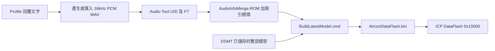

# Audio Tool 回覆語音操作教學

Audio Tool 將 WAV 編碼成 MCU 使用的 NuOne 音訊。回覆文字與功能對照放在 `AudioRes/ReplyPhrases/ReplyProfile.json`；辨識詞以 INI 維護，再由 [DSMT](DSMT_OPERATION_GUIDE.md) 取得發音及建模。

最後產生燒錄檔只使用根目錄 **`BuildLatestModel.cmd`**。音訊來源清單、核對檔、模型封裝及測試文件由工具自動處理。

## 1. 先選擇要做的事

| 目的 | 做法 |
|---|---|
| 同功能增加一句使用者說法，例如「開啟冷氣」 | 在 INI 新增詞條、於 DSMT 匯入，沿用 MapID 1；共用原開機回覆 |
| 修改既有回覆，例如「為您開機」改成「冷氣已開機」 | 修改回覆文字，產生或替換相同檔名的 WAV，再由 Audio Tool 編碼 |
| 改用真人錄音或其他聲音 | 替換相同檔名的 WAV，維持指定格式與功能對照 |
| 新增全新功能及新的回覆種類 | 先完成韌體功能與播放配置，再新增 WAV／UID；見第 6 節 |
| 刪除一種使用者說法 | 在 INI 刪除相應候選並更新 DSMT；同功能其他說法繼續使用原回覆 |
| 刪除整個回覆種類 | 同步功能、播放索引、Profile、UID 及封裝配置；見第 7 節 |

目前提供 23 個音訊片段，涵蓋既有 49 個 MapID。索引 0 為喚醒提示音、1 為共用「好的，」、2～22 為功能主句。指定溫度及定時共用各自的主句，實際數值由 UART 核對。

## 2. 修改讀稿，使用 Windows 聲音

範例：將開機回覆改成「好的，冷氣已開機」。

1. 開啟 `AudioRes/ReplyPhrases/ReplyProfile.json`，找到 `command` 為 `POWER_ON` 的項目。
2. 將其 `text` 改成 `冷氣已開機`，保留檔名 `reply_power_on.wav`、索引 2 及 MapID 1。
3. 儲存 JSON，雙擊根目錄 **`BuildLatestModel.cmd`**。
4. 使用既有 Windows 合成來源時，工具會自動產生新的 WAV，並在需要時開啟 Audio Tool。
5. 在 Audio Tool 確認工程為 `AirconReplies.wba`，按 **F7**。Message Window 應顯示 **0 errors**。
6. 回到一鍵工具視窗按 Enter，工具會接續完成封裝。
7. 依 [README](README.md) 燒錄並試聽「好的，冷氣已開機」，同時核對 `map_id=1` 與 LED。

Windows 自動合成需要 `Microsoft Hanhan Desktop` 聲音。指定聲音可在 Profile 的 `voice` 修改為該電腦已安裝的桌面語音名稱。自錄來源由使用者替換 WAV，工具會保留自錄音訊。

回覆的「好的，」已由共用前綴播放，主句 `text` 與 WAV 只包含「冷氣已開機」。`pronunciation_aliases` 的 `"調": "條"` 讓「調高／調低」讀 `tiáo／ㄊㄧㄠˊ`，顯示文字仍保留「調」。

## 3. 使用真人錄音或匯入 WAV

1. 依下表找到要替換的檔名。
2. 準備 **16 kHz、16-bit、PCM、單聲道** WAV，去除過長的頭尾空白，試聽確認完整句。
3. 放入 `AudioRes/ReplyPhrases/WavSrc/`，使用原檔名。例如修改取消定時回覆，替換 `reply_timer_cancel.wav`。
4. 在 `ReplyProfile.json` 的對應 `text` 記錄新的主句，保持 MapID 與音檔的功能一致。
5. 使用 Audio Tool 完成第 4 節編碼，再雙擊 **`BuildLatestModel.cmd`**。

一鍵工具會更新錄音來源的指紋與回覆文件。變更已發布內容前會建立備份。

## 4. 開啟及設定 Audio Tool

1. 啟動 Nuvoton Audio Tool，選 **File → Open**。
2. 開啟 `AudioRes/ReplyPhrases/AirconReplies.wba`。
3. 在左側 Project Window 雙擊 `AirconReplies.uid`，檢查 `[Audio]` 區段。
4. 各行的檔名對應 `WavSrc/` 中的 WAV，檔名不含 `.wav`。格式如下：

   ```text
   [Audio]
   defaud wake_ok <ext=0, format=NUO, bitrate=1.0>
   defaud reply_prefix <ext=0, format=NUO, bitrate=1.0>
   defaud reply_power_on <ext=0, format=NUO, bitrate=1.0>
   ```

5. `format=NUO` 為 NuOne，`bitrate=1.0` 為 1.0 bits/sample。輸入 WAV 使用 16 kHz，保留既有 UID 檔名與順序。
6. 若找不到 WAV，在 **Project → Options** 核對檔案搜尋目錄包含本工程的 `WavSrc`。輸出位於本工程的 `Output`；搬移專案後以實際專案位置為準。
7. 選 **Project → Build** 或按 **F7**。需要完整重建時使用 **Project → Rebuild All**。
8. 在 Message Window 確認 `0 errors`，檢查下列產物已更新：

   | 產物 | 位置／用途 |
   |---|---|
   | `AirconReplies_AudioInfoMerge.ROM` | `Output/`，編碼音訊及索引 |
   | `AirconReplies_AudioInfo.h` | `Output/`，音檔名稱與實際索引 |

9. 雙擊 **`BuildLatestModel.cmd`**；若一鍵工具已在等待編碼，回到原視窗按 Enter 即可。

工具會核對 Profile、WAV、UID、索引標頭、ROM 格式及 Flash 容量。完成後使用 `CMDSet/ReleaseV005/AirconDataFlash.bin` 燒錄；不需手動複製 ROM 或執行其他封裝批次檔。

## 5. 回覆音檔對照

| 索引 | 功能 | WAV 檔案 | 主句 | MapID |
|---:|---|---|---|---|
| 0 | wake | `wake_ok.wav` | 提示音 | 1001/1002/1003 |
| 1 | prefix | `reply_prefix.wav` | 好的， | 共用前綴 |
| 2 | POWER_ON | `reply_power_on.wav` | 為您開機 | 1 |
| 3 | POWER_OFF | `reply_power_off.wav` | 為您關機 | 2 |
| 4 | MODE_COOL | `reply_mode_cool.wav` | 切換冷氣模式 | 3 |
| 5 | MODE_HEAT | `reply_mode_heat.wav` | 切換暖氣模式 | 4 |
| 6 | MODE_DRY | `reply_mode_dry.wav` | 切換除濕模式 | 5 |
| 7 | MODE_AUTO | `reply_mode_auto.wav` | 切換自動模式 | 6 |
| 8 | TEMP_UP | `reply_temp_up.wav` | 溫度已調高 | 7 |
| 9 | TEMP_DOWN | `reply_temp_down.wav` | 溫度已調低 | 8 |
| 10 | FAN_UP | `reply_fan_up.wav` | 風量已調大 | 9 |
| 11 | FAN_DOWN | `reply_fan_down.wav` | 風量已調小 | 10 |
| 12 | FAN_AUTO | `reply_fan_auto.wav` | 風量已設為自動 | 11 |
| 13 | SWING_AUTO | `reply_swing_auto.wav` | 風向設定為自動 | 12 |
| 14 | SWING_HOLD | `reply_swing_hold.wav` | 風向已固定 | 13 |
| 15 | NANOE_ON | `reply_nanoe_on.wav` | 已開啟 奈諾伊 | 14 |
| 16 | NANOE_OFF | `reply_nanoe_off.wav` | 已關閉 奈諾伊 | 15 |
| 17 | VOICE_VOL_UP | `reply_voice_vol_up.wav` | 音量已調大 | 16 |
| 18 | VOICE_VOL_DOWN | `reply_voice_vol_down.wav` | 音量已調小 | 17 |
| 19 | VOICE_MUTE | `reply_voice_mute.wav` | 已關閉語音 | 18 |
| 20 | TIMER_CANCEL | `reply_timer_cancel.wav` | 定時已取消 | 19 |
| 21 | TEMP_SET | `reply_temp_set.wav` | 溫度已設定 | 116~130 |
| 22 | TIMER_OFF | `reply_timer_off.wav` | 定時已設定 | 201~212 |

修改完整句時，共用前綴與功能主句分別處理。對照表中的主句會與「好的，」組合；喚醒提示音直接播放。

## 6. 增加全新的回覆種類

新增辨識別名、沿用既有 MapID 時，直接共用原回覆。若是新功能或需要額外的獨立音訊片段，先由韌體維護者完成 MapID、播放索引及容量配置；目前 23 個片段的配置不會因新增 WAV 自動擴充。

配置完成後，音訊操作如下：

1. 在 `WavSrc/` 加入新 WAV，格式保持 16 kHz、16-bit PCM、單聲道。
2. 在 Profile 登記回覆文字、檔名、索引與 MapID。
3. 在 Audio Tool 的 UID 加入相應項目，例如：

   ```text
   defaud reply_new_feature <ext=0, format=NUO, bitrate=1.0>
   ```

4. F7 建置，依輸出的 `AudioInfo.h` 核對實際索引。
5. 雙擊 **`BuildLatestModel.cmd`**，完成容量核對及封裝，再燒錄測試。

新功能的韌體與工具配置位置見 [工程維護](docs/DEVELOPMENT.md)。

## 7. 刪除回覆或功能

刪除辨識別名時，保留供同 MapID 其他說法使用的回覆。移除整個功能及其回覆時：

1. 在兩語 INI 與功能模板中移除此功能，更新 DSMT 相應群組並儲存模型。
2. 在 `AirconCommands_Decode()` 移除功能，在 `AirconAudio_Reply()` 移除其回覆對應；先核對其他功能是否共用同一主句。
3. 移除不再使用的 Profile 項目與 UID 行，再刪除其 WAV。其他功能仍使用的共用前綴、溫度／定時主句繼續保留。
4. 同步 `AIRCON_AUDIO_COUNT`、其後所有索引，以及封裝器的片段數、MapID 覆蓋與來源核對規則。
5. 在 Audio Tool 使用 Rebuild All，以新 `AudioInfo.h` 核對索引，重新編譯封裝器與 Keil APP。
6. 執行同一個 `BuildLatestModel.cmd`，更新 APROM／DataFlash 並驗證保留功能的回覆。

完整程式修改位置見 [README：新增或移除功能](README.md#新增或移除功能)。

## 8. 編碼與最終合併



工具自動產生 `AirconReplies.bin` 與 `AirconModels.bundle.bin`，再按 Flash 位址合併；使用者直接燒錄最終 `AirconDataFlash.bin`。程式有變更時，同步燒錄 APROM 的 `DNN_NuOne_UAC.bin`。

原廠操作參考：工具套件隨附的《Audio Tool User Guide》，Quick Start、UID Files、UID & IDT Conversion 及 Output Files 章節。
