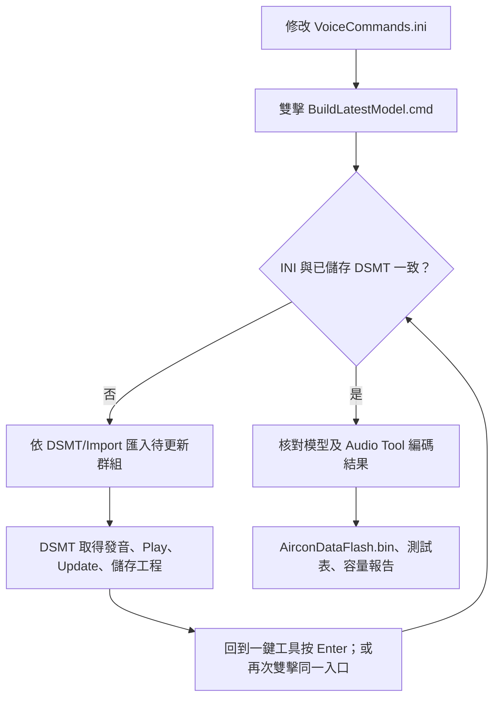

# INI 與 DSMT 辨識語音操作教學

辨識規格統一維護於 **[DSMT/VoiceCommands.ini](DSMT/VoiceCommands.ini)**。DSMT 負責取得有效發音、試聽及產生模型；冷氣回覆的聲音另由 [Audio Tool](AUDIO_TOOL_GUIDE.md) 管理。最後都使用根目錄 **`BuildLatestModel.cmd`** 產生燒錄檔，不需安裝 Python。



INI 轉換採 DSMT 官方的 UTF-16LE 群組／批次新增格式。匯入並儲存後，得到有效的 `.dsmt` 與模型檔；發音 ID、聲學模型由 DSMT 產生。

## 1. 檔案位置與用途

| 檔案／目錄 | 維護方式 |
|---|---|
| `DSMT/VoiceCommands.ini` | 修改辨識詞條、語系、群組、參數、MapID 與指定發音 |
| `DSMT/Import/` | 一鍵工具產生的 DSMT 匯入資料 |
| `DSMT/Combine/Working/ChineseTWN/AirconZHTW.dsmt` | 國語工程，在 DSMT 開啟與儲存 |
| `DSMT/Combine/Working/Taiwanese/Taiwanese.dsmt` | 台語工程，在 DSMT 開啟與儲存 |
| `DSMT/Input/CommandManifest.json` | 工具同步的功能與詞條清單 |
| `DSMT/Input/IniModelState.json` | 工具同步的模型狀態 |
| `CMDSet/ReleaseV005/AirconDataFlash.bin` | 雙語模型與回覆音訊整合燒錄檔 |

詞條規格由 INI 維護。隨附範例包含國語 84 筆、台語 215 筆發音候選；不同候選可共用同一命令文字及 MapID。

## 2. INI 格式

使用支援 UTF-8 的文字編輯器開啟 INI，儲存為 **UTF-8**。檔案已有 UTF-8 BOM，建議保留。

```ini
[Format]
Version=1

[Project.ChineseTWN]
Language=Chinese(TWN)
NativeProject=DSMT/Combine/Working/ChineseTWN/AirconZHTW.dsmt

[ChineseTWN.Group_2_Power]
; No=Command|Reward|SGReward|ExtEnd|MapID|FastSpeech|Phoneme
0=開機|0|0|0|1|N|<zh-TW>kai1.ji1
1=開冷氣|0|0|0|1|N|<zh-TW>kai1.leng3.qi4
```

`Project.ChineseTWN` 定義語系與工程路徑；`ChineseTWN.Group_2_Power` 指定此語系的群組。每列等號左邊是 **No**，右邊固定七欄，以半形 `|` 分隔。

| 欄位 | 說明／填法 |
|---|---|
| Language | DSMT 語系名稱：國語 `Chinese(TWN)`；台語 `Taiwanese` |
| GROUP | 區段中的 `Group_數字_名稱`，須與工程的名稱及排列一致 |
| No | 組內排序，從 0 起算；不可重複，可留間隔；工具依數字排序 |
| Command | 使用者說的詞條；填原文字，不加畫面的 `^1` 等候選後綴 |
| Reward | Confi. Reward，整數；工具接受 -100～100，官方建議調整範圍 -10～10 |
| SGReward | SG Diff. Reward，整數；工具接受 -100～100，官方建議調整範圍 -10～10 |
| ExtEnd | Extra Ending，單位為秒；範圍 0～0.48，每格 0.03 秒；`0.12` 匯出為 4 個結尾靜音 frames |
| MapID | 韌體功能編號；同功能的兩語說法、別名與發音候選使用同一編號 |
| FastSpeech | `Y` 啟用、`N` 停用；提高快速語音適應性，也可能提高誤觸發 |
| Phoneme | 完整 DSMT 音素，包含 `<zh-TW>` 或 `<zh-NAN>`；新詞可留白，由 DSMT 取得發音 |

No 是排序用途，UART 的 `map_id` 是功能用途。留白發音經 DSMT 展開多個候選後，一鍵工具會將實際候選寫回 INI，重新編排該群組的 No。

- 每列須保留七欄；Phoneme 留白時保留最後一個 `|`。
- 註解獨立一行，以 `;` 或 `#` 開頭；欄位內容不加行尾註解或引號。
- `|` 是分隔符號，詞條及音素不使用此字元。
- 同句不同發音各占一列，填明確 Phoneme；同句交由 DSMT 產生發音時，只留一列空白 Phoneme。
- GROUP 沿用現有九組及其順序；每組保留詞條，每個既有功能至少保留一個說法。

## 3. 分組與 MapID

| 群組 | 內容 | MapID |
|---|---|---|
| Group_1_Wake | 房間／客廳／全域喚醒 | 1001／1002／1003 |
| Group_2_Power | 開機、關機 | 1／2 |
| Group_3_Mode | 冷氣、暖氣、除濕、自動 | 3／4／5／6 |
| Group_4_Temperature | 調高、調低、指定溫度 | 7／8、116～130 |
| Group_5_Fan | 風量增加、減少、自動 | 9／10／11 |
| Group_6_Swing | 自動風向、固定風向 | 12／13 |
| Group_7_Health | 開啟、關閉 nanoe | 14／15 |
| Group_8_Volume | 音量增加、減少、靜音 | 16／17／18 |
| Group_9_Timer | 定時關機、取消定時 | 201～212、19 |

喚醒群組放第一組。國語、台語相同功能使用相同 MapID；`1001/1002/1003` 分別代表 ROOM／LIVING／GLOBAL。指定溫度使用 `100＋度數`，定時關機使用 `200＋小時`。

## 4. 新增同 MapID 的命令詞：完整範例

範例：新增國語「開啟冷氣」，沿用開機功能。

1. 開啟 `DSMT/VoiceCommands.ini`，找到 `[ChineseTWN.Group_2_Power]`。目前 No 為 0～5，在該區段末端加入：

   ```ini
   6=開啟冷氣|0|0|0|1|N|
   ```

2. 儲存 INI，雙擊根目錄 **`BuildLatestModel.cmd`**。
3. 工具顯示待套用 `ChineseTWN/Group_2_Power`，並更新 `DSMT/Import/README.md` 與匯入檔。視窗可保持開啟。
4. 在 DSMT 登入，使用「檔案 → 載入專案」開啟國語工程：`DSMT/Combine/Working/ChineseTWN/AirconZHTW.dsmt`。
5. 選取 **Group_2_Power**。在指令列表選第一列，再按住 Shift 選最後一列，按「刪除」，清空此組詞條。群組及 Global 設定沿用原工程。
6. 按「批次新增」，選擇 **`DSMT/Import/ChineseTWN/Group_2_Power.BatchAdd.txt`**。此檔包含該群組原有及新增的完整詞條。
7. 等待 DSMT 完成發音處理。檢查新增詞條文字、MapID=1、Reward、SGReward、ExtEnd、FastSpeech。
8. 選取新增詞條按「播音」。需要調整時修改發音欄，按「更新」，再試聽；若有多個候選，逐列核對 MapID。
9. 按「儲存專案」或 Ctrl+S，等待 DSMT 完成模型產生。工程設定沿用 **16 kHz、23d、100 fps、Level 1、32-bit、4-byte alignment**。
10. 回到一鍵工具按 Enter；若視窗已關閉，再次雙擊同一個 **`BuildLatestModel.cmd`**。
11. 成功後，工具自動將新詞實際發音候選寫回 INI、更新測試文件，產生 **`CMDSet/ReleaseV005/AirconDataFlash.bin`**。
12. 開啟最新逐句表，確認「開啟冷氣」與 MapID=1；燒錄後說「房間冷氣」，等回覆結束，再說「開啟冷氣」，核對 UART、語音與 LED。

新增台語說法的操作相同，改用 `[Taiwanese.Group_2_Power]`、台語工程及 `DSMT/Import/Taiwanese/` 的檔案。No 使用該群組尚未使用的數字，MapID 仍為 1。新別名共用此功能的既有回覆。

只更新工具列出的待套用群組，其他群組繼續使用已儲存工程。`DSMT/Import/` 由 INI 產生，後續修改仍回到 INI。

匯入檔分為兩種：`.BatchAdd.txt` 僅含詞條，供現有群組「批次新增」使用；`.txt` 含官方 XML 設定，供「群組 → 匯入群組」使用。兩者均為 UTF-16LE。日常修改採上述批次新增流程，保留現有群組順序。

## 5. 修改文字、刪除別名

1. 在 INI 找到語系、群組與 No，可用文字或 MapID 搜尋。
2. 修改文字時同步核對發音。整句內容改變，可將此句 Phoneme 留白，交由 DSMT 取得新發音；同句多個候選先合為一列。
3. 刪除別名時，刪除該句所有候選列，保留此功能其他說法。
4. 執行 `BuildLatestModel.cmd`，依第 4 節更新待套用群組並儲存，再完成一鍵產生。

DSMT 的 Rename 會保留原發音；整句文字改變時需核對完整發音。

## 6. 修改發音、增加口音候選

**已知音素：** 在 INI 修改最後一欄 Phoneme；增加候選時複製同句一列，使用新 No、相同 MapID 及另一組完整 Phoneme。執行一鍵工具，在 DSMT 匯入該群組，按「播音」確認並儲存，再完成產生。

**需要先在 DSMT 試音：** 在 INI 將該句合為一列，Phoneme 留白；在 DSMT 調整該句完整發音、按「更新」並儲存，再執行一鍵工具。若同時修改文字或其他參數，先依第 4 節匯入該群組，再於 DSMT 試音與儲存。成功產生時，實際發音候選自動寫回 INI。

Phoneme 留白且其他設定與已儲存工程一致時，工具可採用該工程的有效發音。畫面上的 `^1`、`^2` 是候選序號；INI 的 Command 與口說都使用原命令，候選後綴由轉換工具產生。

台語完整音節、聲調及全部候選見 [TaiwanesePronunciation.md](DSMT/Test/TaiwanesePronunciation.md)。

## 7. nanoe 與台語聲調

| 項目 | 設定 |
|---|---|
| nanoe 顯示文字 | 可保留 `nanoe` |
| 國語口說 | 奈諾伊；產品名音素 `nai4.nuo4.yi1` |
| 台語「開 nanoe」 | `<zh-NAN>khui7.nai3.noo3.i1` |
| 台語「關 nanoe」 | `<zh-NAN>kuainn7.nai3.noo3.i1` |
| 台語「溫度攑懸」 | `<zh-NAN>un7.too7.gia3.kuan5`；`gia3` 為第三調低降 |

品牌名稱可先以「奈諾伊」產生有效發音，再保留讀音修改顯示文字。各語言使用相應音素表。

## 8. 調整辨識參數

在 INI 修改 Reward、SGReward、ExtEnd 或 FastSpeech，執行一鍵工具，重新匯入該組並在 DSMT 儲存模型。工具會比對 INI、原生工程及模型狀態；筆數相同的參數變更也需要重新建模。

較大的 Reward／SGReward 使詞條較容易通過，也可能增加誤觸發。ExtEnd 會加在群組 Ending Silence 上。一次調整一項，完成原命令、相近說法、背景對話及國台語交叉測試。

整組 Global 設定在 DSMT 調整，重新儲存後測該組完整清單。群組匯入檔沿用原工程 Global 設定。參數、音素及批次新增格式見 [Cyberon DSMT 官方指南](https://tool.cyberon.com.tw/DSMT_V2/index.php?lang=en)。

## 9. 產生、燒錄與測試

DSMT 儲存後，同一個 **`BuildLatestModel.cmd`** 自動核對 INI 與模型、寫回新詞發音、更新清單、合併音訊與雙語模型、更新容量報告及三份測試文件。

最新整合檔位於 `CMDSet/ReleaseV005/AirconDataFlash.bin`，DataFlash 起點為 `0x15000`。首次使用或程式有修改時，同步更新 APROM `0x00000000` 的 `DNN_NuOne_UAC.bin`。燒錄後 Verify、Reset，依 [逐句表](DSMT/Test/UserCommandTestGuide.txt) 測試喚醒＋命令，核對回覆、LED 與 UART。完整步驟見 [README](README.md)。

若仍列出待套用群組，核對載入工程路徑、批次新增檔、發音、參數及是否完成「儲存專案」。若提示「模型尚未更新」，回到 DSMT 儲存並產生該組模型，再執行同一入口。

## 10. 其他專案沿用

可沿用相同 INI 欄位格式及群組匯入方式。新專案需先在 DSMT 建立有效工程、設定語系與聲學參數，再配置 INI 的 Project、NativeProject 與各 GROUP。

本專案的燒錄封裝、九組配置、兩語工程路徑、49 個功能 MapID 與回覆音訊對應 I94124 冷氣程式。移植其他專案時，維護者同步修改功能定義、模型載入及封裝設定。

新增全新功能、超出 16～30 度或 1～12 小時範圍時，先完成韌體功能定義；步驟見 [工程維護](docs/DEVELOPMENT.md)。
