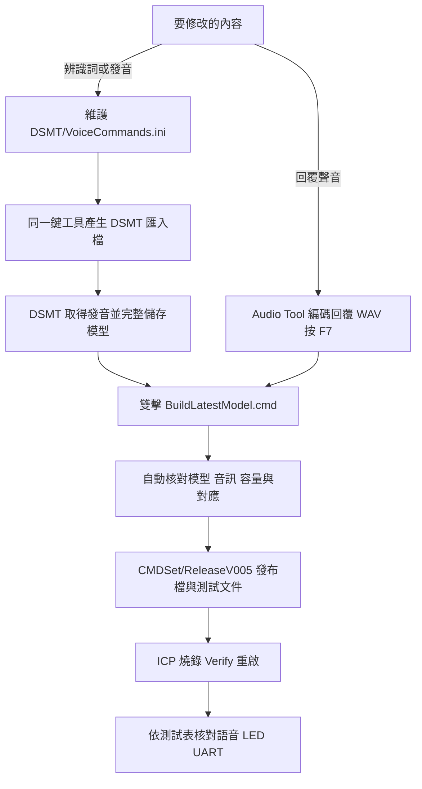
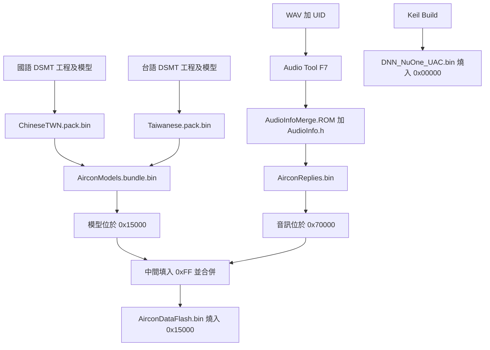
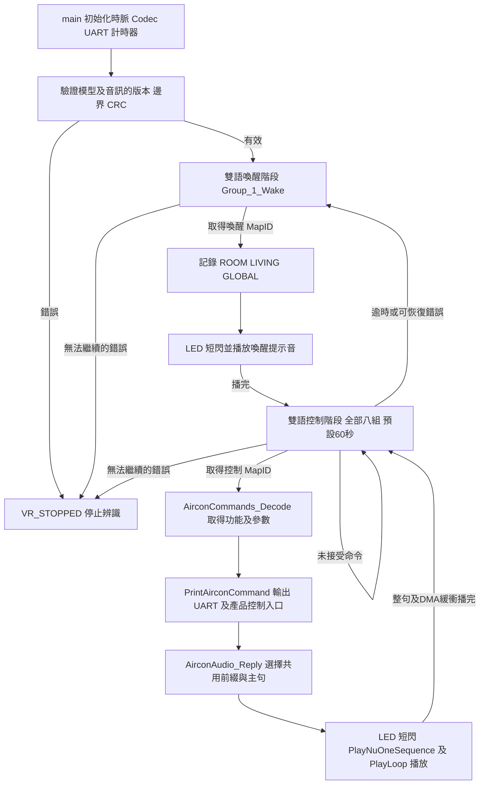

# I94124 國語／台語語音控制範例

本範例使用 I94124、NAU88C22 與 Cyberon DSpotter，示範國語及台語同時辨識、MapID 解碼、語音回覆及 LED 提示。

- 命令辨識成功後播放國語回覆，並讓 PB0／D4 LED 短閃。
- UART 輸出功能、區域及溫度／定時參數。
- 冷氣控制協定或 GPIO 可在應用層接入。

## 快速開始

| 工作 | 開啟位置 |
|---|---|
| 修改辨識詞、說法或發音 | [VoiceCommands.ini](DSMT/VoiceCommands.ini) → [DSMT 操作教學](DSMT_OPERATION_GUIDE.md) |
| 修改冷氣回覆 | [Audio Tool 操作教學](AUDIO_TOOL_GUIDE.md) |
| 產生最新燒錄檔 | 雙擊 **[BuildLatestModel.cmd](BuildLatestModel.cmd)** |
| 查容量與燒錄檔指紋 | [BuildReport.md](CMDSet/ReleaseV005/BuildReport.md) |
| 查命令、MapID 與回覆 | [CommandMapIDQuickReference.md](DSMT/Test/CommandMapIDQuickReference.md) |
| 查台語讀法 | [TaiwanesePronunciation.md](DSMT/Test/TaiwanesePronunciation.md) |
| 完整逐句測試 | [UserCommandTestGuide.txt](DSMT/Test/UserCommandTestGuide.txt) |

語音產物使用 `BuildLatestModel.cmd`，不需安裝 Python。工具自動同步 INI 詞條、核對音訊、封裝模型及更新測試文件。

閱讀順序：[修改辨識語音](#修改辨識語音) → [修改回覆語音](#修改回覆語音) → [一鍵產生的結果](#一鍵產生的結果) → [燒錄](#燒錄) → [測試](#測試)。程式結構見 [程式如何執行](#程式如何執行)。



## 支援功能

| 項目 | 設定 |
|---|---|
| 辨識語言 | 國語 `Chinese(TWN)`、台語 `Taiwanese` 同時啟用 |
| 分類 | 喚醒、電源、模式、溫度、風量、風向、健康、音量、定時，共 9 組 |
| 指定溫度 | 16～30 度，每度一項 |
| 定時關機 | 1～12 小時，每小時一項，另有取消定時 |
| 控制等待 | 預設 60 秒，成功命令與完整回覆結束後重新計時 |
| 健康功能 | 開關範例詞條；完整命令及讀法見測試文件 |
| 回覆 | 兩語共用國語回覆；16 kHz、NuOne 1.0 bits/sample，位於內部 Flash |
| 指定溫度回覆 | 「好的，溫度已設定」，數值由 UART 核對 |
| 定時設定回覆 | 「好的，定時已設定」，小時數由 UART 核對 |

同一功能的不同說法可共用 MapID；不同溫度或小時數使用各自的 MapID。完整詞條、台語 DSMT 羅馬拼音及回覆以一鍵產生後的測試文件為準。

## 工具需求

| 工作 | 所需工具 |
|---|---|
| 直接燒錄發布檔 | Nuvoton ICP、Nu-Link |
| 修改辨識詞或發音 | Cyberon DSMT V2 與可用帳號 |
| 編碼回覆 WAV | Nuvoton Audio Tool |
| 一鍵封裝及產生文件 | Windows PowerShell 5.1、.NET Framework 4.5 以上；使用隨專案提供的執行檔 |
| 依文字自動產生國語 WAV | Windows `Microsoft Hanhan Desktop` 聲音；自錄 WAV 可略過語音合成 |
| 修改韌體或增加全新功能 | Keil µVision、已啟用授權的 Arm Compiler 6、Nuvoton I94124 裝置及 Nu-Link 支援 |

## 修改辨識語音

完整欄位、分組、MapID、台語音素與匯入步驟見 [DSMT 操作教學](DSMT_OPERATION_GUIDE.md)。日常修改由 INI 維護規格，再由 DSMT 取得發音與產生模型。

### 新增一種說法

範例：新增國語「開啟冷氣」，與「開機」共用 MapID=1。

1. 使用文字編輯器開啟 `DSMT/VoiceCommands.ini`，儲存編碼使用 UTF-8。
2. 找到 `[ChineseTWN.Group_2_Power]`，使用未占用的 No 加入一列；隨附工程可使用 6：

   ```ini
   ; No=Command|Reward|SGReward|ExtEnd秒數|MapID|FastSpeech|Phoneme
   6=開啟冷氣|0|0|0|1|N|
   ```

3. 儲存後雙擊 `BuildLatestModel.cmd`。工具列出待更新群組，產生 `DSMT/Import/ChineseTWN/Group_2_Power.BatchAdd.txt`。
4. 在 DSMT 登入，開啟 `DSMT/Combine/Working/ChineseTWN/AirconZHTW.dsmt`，選 `Group_2_Power`。
5. 在指令列表選第一列，再按住 Shift 選最後一列，按「刪除」清空該組詞條。保留原群組與 Global 設定。
6. 按「批次新增」，讀取第 3 步的 `.BatchAdd.txt`。此檔包含該組全部詞條，會一併加入原有說法與新說法。
7. 等 DSMT 取得發音；檢查 MapID、按「播音」試聽。需要調整發音時，修改音素並按「更新」。
8. 按「儲存專案」或 Ctrl+S，等待模型產生完成。
9. 回到一鍵工具按 Enter；若已關閉，再次雙擊同一個 `BuildLatestModel.cmd`。
10. 工具將新詞實際發音寫回 INI，產生 BIN 與測試文件。依後文燒錄並測試新說法。

台語採相同步驟：區段改為 `[Taiwanese.Group_2_Power]`，使用台語工程 `DSMT/Combine/Working/Taiwanese/Taiwanese.dsmt` 及 `DSMT/Import/Taiwanese/` 的匯入檔。新說法共用同功能的既有回覆。

### 修改文字、發音與參數

1. 在 INI 搜尋詞條或 MapID，找到對應語系與群組。
2. 修改 Command 時核對完整發音；整句改變，可將該句合為一列並讓 Phoneme 留白，由 DSMT 取得新發音。
3. 已知正確音素時，直接修改 Phoneme。增加口音候選時複製同句一列，使用新 No、相同 MapID 與另一組完整音素。
4. 參數欄位分別為 Reward、SGReward、ExtEnd、FastSpeech。ExtEnd 以秒輸入，每格 0.03 秒，範圍 0～0.48；FastSpeech 填 Y／N。
5. 執行一鍵工具，依上述第 4～10 步重新匯入待更新群組、試聽、儲存及產生。

需要先在 DSMT 試音時，依 [發音調整教學](DSMT_OPERATION_GUIDE.md#6-修改發音增加口音候選) 將該句 Phoneme 留白，於 DSMT 調整並儲存；成功產生時再由工具寫回 INI。

### 刪除一種說法

1. 在 INI 刪除該句的所有候選列。例如刪除國語「開空調」，保留「開機」「開冷氣」等 MapID=1 的其他說法。
2. 保留此功能至少一個說法及現有九組順序；No 可留間隔。
3. 執行一鍵工具，重新匯入整個受影響群組並儲存 DSMT 模型，再完成產生。
4. 核對更新後的逐句表已移除該句，並測試保留的別名、鄰近說法及兩語命令。

刪除別名後，共用 MapID 的回覆仍供其他別名使用。移除整個功能或群組時，依 [新增或移除功能](#新增或移除功能) 同步功能與韌體配置。

### 完成辨識模型修改

1. 修改 **`DSMT/VoiceCommands.ini`** 的對應語系與 GROUP，填寫命令詞、參數、MapID；新詞的 Phoneme 可留白。
2. 雙擊 **`BuildLatestModel.cmd`**，工具產生 `DSMT/Import/` 匯入資料，列出待套用群組。
3. 在 DSMT 開啟 Working 中的對應工程，依 [教學](DSMT_OPERATION_GUIDE.md) 批次匯入該組，取得發音、試聽並儲存模型。
4. 回到一鍵工具按 Enter，或再次雙擊同一入口。工具核對後將新詞發音寫回 INI，產生最新 `AirconDataFlash.bin` 與測試表。

同功能沿用 MapID，例如「開機／開冷氣／開啟冷氣」皆為 `1`。

- 辨識規格由 `VoiceCommands.ini` 維護，無需 Excel 編輯器。
- 隨附範例包含國語 84 筆、台語 215 筆發音候選。
- 新增全新功能或 MapID 時，同步完成韌體功能定義。

## 修改回覆語音

完整步驟、WAV 對照及新增回覆的適用範圍見 [Audio Tool 操作教學](AUDIO_TOOL_GUIDE.md)。

**依文字產生回覆：**

1. 在 `AudioRes/ReplyPhrases/ReplyProfile.json` 修改對應功能的 `text`，例如將開機主句改成「冷氣已開機」。
2. 雙擊 **`BuildLatestModel.cmd`**。工具會依文字產生 WAV，並在需要時開啟 Audio Tool。
3. 依畫面提示，在 Audio Tool 按 **F7**，確認 `0 errors`。
4. 回到一鍵工具按 Enter，工具會接續產生最新燒錄檔。

例如開機項目的關鍵欄位如下；編輯既有 JSON 時保留其他欄位及合法逗號：

```json
{
  "index": 2,
  "file": "reply_power_on.wav",
  "role": "body",
  "command": "POWER_ON",
  "text": "冷氣已開機",
  "map_ids": [1]
}
```

**使用自錄或匯入的 WAV：**

1. 將對應 WAV 放入 `AudioRes/ReplyPhrases/WavSrc/`，格式為 **16 kHz、16-bit PCM、單聲道**，同步回覆文字。
2. 用 Audio Tool 開啟 `AirconReplies.wba`，按 F7，確認 `0 errors`。
3. 雙擊 **`BuildLatestModel.cmd`**。

回覆以共用「好的，」加上主句組成；主句 WAV 只錄主句。工具保留自錄來源，修改自錄回覆時由使用者替換 WAV。

### 更換提示音、新增或刪除回覆

| 需求 | 操作 |
|---|---|
| 更換喚醒提示音 | 替換 `WavSrc/wake_ok.wav`，維持 16 kHz、16-bit PCM、單聲道；Audio Tool F7 後執行一鍵工具 |
| 新增同功能辨識別名 | 在 INI 新增相同 MapID 的說法，共用原有回覆 |
| 修改既有回覆文字或聲音 | 修改原 Profile 項目及同名 WAV，保留索引與 MapID，再 F7 及一鍵產生 |
| 刪除辨識別名 | 刪除 INI 對應候選，保留供同功能其他說法使用的回覆 |
| 增加獨立音訊片段、刪除整個回覆種類 | 依下節同步韌體播放索引、Profile、UID 及封裝設定，再 F7 與建置 |

回覆配置包含 23 個片段、49 個功能 MapID。

- 每個受支援功能都有回覆對應。
- 增減片段時同步修改 WAV、UID、播放索引及封裝配置。
- 完整對照與操作見 [Audio Tool 教學](AUDIO_TOOL_GUIDE.md)。

## 新增或移除功能

新增全新 MapID、刪除整個功能、增加回覆種類，或擴充溫度／定時範圍時，依序同步下列位置：

1. 在 `DNN_VR/AirconCommands.c` 的 `AirconCommands_Decode()` 定義 MapID、功能、參數與單位；在 `DSMT/Input/CommandManifest.json` 建立或移除兩語功能模板。
2. 在 INI 新增或移除兩語詞條，於 DSMT 更新相應群組並儲存。功能模板與 INI 使用相同的分類及 MapID。
3. 在 `DNN_VR/AirconAudio.c` 的 `AirconAudio_Reply()` 設定 MapID 對應片段；改變片段數時，更新 `AirconAudio.h` 的 `AIRCON_AUDIO_COUNT` 與相關容量配置。
4. 在 `ReplyProfile.json`、WAV 與 Audio Tool UID 同步新增／移除項目，F7 後以 `AirconReplies_AudioInfo.h` 核對實際索引。移除中間片段時，後續索引一併調整。
5. 在 `DSMT/AirconBundleBuilder.cs`、`DSMT/ReplyAudioBuild.ps1`、`AudioRes/ReplyPhrases/SealAudioBuild.ps1` 同步片段數、MapID 覆蓋與來源核對規則；開發用 Python 參考及測試亦需同步。
6. 執行 `DSMT/build_bundle_tool.cmd` 重新編譯封裝器，在 Keil 開啟 `Prj/KEIL/I94_Cyberon.uvproj`，Target 選 `UsbCallBack` 並 Build／Rebuild。
7. 雙擊根目錄 `BuildLatestModel.cmd`，確認容量報告、BIN 及測試文件，再更新 APROM 與 DataFlash，完成受影響功能及兩語測試。

既有功能增加或刪除「說法」依前述 INI／DSMT 流程操作；本節用於功能及音訊配置的程式變更。各模組職責見下方程式流程，詳細維護位置見 [工程維護](docs/DEVELOPMENT.md)。

## 一鍵產生的結果

工具成功後更新：

| 位置 | 內容 |
|---|---|
| `CMDSet/ReleaseV005/DNN_NuOne_UAC.bin` | APROM 韌體 |
| `CMDSet/ReleaseV005/ChineseTWN.pack.bin`、`Taiwanese.pack.bin` | 各語言的模型封裝 |
| `CMDSet/ReleaseV005/AirconModels.bundle.bin` | 國語與台語模型整合包 |
| `CMDSet/ReleaseV005/AirconReplies.bin` | 加上長度、版本與 CRC 的 NuOne 回覆音訊 |
| `CMDSet/ReleaseV005/AirconDataFlash.bin` | 雙語模型與內部回覆音訊整合檔 |
| `CMDSet/ReleaseV005/ModelManifest.json` | 發布檔長度、SHA-256 與模型資訊 |
| `CMDSet/ReleaseV005/BuildReport.md` | Flash／RAM 用量及剩餘容量 |
| `DSMT/Test/UserCommandTestGuide.txt` | 完整喚醒＋命令逐項測試表 |
| `DSMT/Test/CommandMapIDQuickReference.md` | 兩語命令、MapID 與回覆 |
| `DSMT/Test/TaiwanesePronunciation.md` | 台語實際拼音與全部候選 |

內容有變動時，工具會先將待更新檔案備份至 `_Archive/Before_VoiceUpdate_*.zip`。已填測試表亦包含在備份中；新產生的測試結果欄為未測狀態。

若 Audio Tool 尚未完成編碼，依工具提示按 F7 後繼續。若 DSMT 工程與模型不一致，回到 DSMT 完整儲存。詳細紀錄位於 `DSMT/Test/ProjectBuild_*.log`。

所有模型及音訊 BIN 的合併均由同一入口完成，以下為產物關係：



`AirconDataFlash.bin` 不包含 APROM 韌體。模型或音訊變更後產生新的 DataFlash；程式有修改時，Keil 先產生 APP，再由一鍵工具更新同一發布目錄。

## 燒錄

1. 連接 Nu-Link、板卡電源與喇叭，開啟 NuMicro ICP。
2. 選擇 I94124，確認 Config 的 DataFlash 起點為 **`0x15000`**。
3. 選擇以下檔案：

   | 區域 | 起點 | 檔案 |
   |---|---|---|
   | APROM | `0x00000000` | `CMDSet/ReleaseV005/DNN_NuOne_UAC.bin` |
   | DataFlash | `0x00015000` | `CMDSet/ReleaseV005/AirconDataFlash.bin` |

4. 執行燒錄與 Verify，完成後重啟。
5. UART 設為 **115200、8N1**，確認 `[APP] release=V005`、`[AUDIO_READY]` 與 `[VR_READY] languages=2`。

首次使用或韌體有變動時更新 APROM 及 DataFlash。板上已有相容韌體、僅變更辨識模型或回覆時，可只更新 DataFlash。回覆存放於內部 Flash，外接 SPI Flash 沿用原設定。

## 測試

1. 開啟 [逐句測試表](DSMT/Test/UserCommandTestGuide.txt)，設定 UART 並保存紀錄。
2. 說國語「房間冷氣」，等喚醒提示音與 LED 短閃結束。
3. 說「開機」，核對 `map_id=1 command=POWER_ON`，並確認「好的，為您開機」及 LED 短閃。
4. 等回覆播完，再用台語說命令；依 [拼音表](DSMT/Test/TaiwanesePronunciation.md) 對照發音與 MapID。
5. 依測試表完成每個國語／台語別名、溫度 16～30 度、定時 1～12 小時，以及喚醒與命令交叉組合。
6. 核對 `[VR_MEMORY] total` 在 `available` 範圍內。新增詞條後重新量測喚醒及控制階段。

控制等待期間未接受命令時可直接重說；回覆播放期間等整句結束後再說。看到 `[VR_TIMEOUT]` 或返回等待喚醒時，重新說喚醒詞。UART 顯示的功能、區域、參數及語音回覆均符合測試表，才將該次記為通過。

## 程式如何執行

國語及台語引擎接收同一份麥克風 PCM。喚醒階段只啟用第一組，控制階段同時啟用其餘八個分類群組。接受的 MapID 轉為共用功能，再由應用層輸出 UART、播放國語回覆及觸發 LED。



播放期間暫停辨識，整句播完後重新開始 60 秒控制視窗。一般漏辨繼續同一視窗；逾時後清除房間區域並等待新的喚醒。

| 程式位置 | 職責與修改用途 |
|---|---|
| [main.c](Src/app/src/main.c) | `main()` 管理階段；`PrintAirconCommand()` 輸出功能、區域及數值，是 GPIO／通訊控制整合位置；`AcknowledgeDecode()` 啟動聲光回饋 |
| [VR.c](DNN_VR/VR.c) | `VR_TakeFrame()` 安全複製中斷產生的 480 點 PCM；16 kHz 下每份 30 ms |
| [AirconVR.c](DNN_VR/AirconVR.c) | `AirconVR_Recognize()` 配置兩語 SDK 記憶體、餵入相同 PCM、處理候選、計時及釋放引擎 |
| [AirconModels.c](DNN_VR/AirconModels.c) | `AirconModels_Load()` 解析 Flash 中的雙語封裝，檢查 CRC、長度及群組順序 |
| [AirconCommands.c](DNN_VR/AirconCommands.c) | MapID 轉為功能、溫度、小時及喚醒區域；兩語相同功能共用此對照 |
| [AirconAudio.c](DNN_VR/AirconAudio.c) | 驗證音訊映像，依 MapID 產生提示音或「前綴＋主句」索引 |
| [PlayNuOne.c](Play/PlayNuOne.c) | NuOne 解碼、片語串接、120 ms 間隔及 I²S／PDMA 雙緩衝播放；最後緩衝播完才恢復辨識 |
| [AirconFeedback.c](DNN_VR/AirconFeedback.c) | Timer1 每 1 ms 推進 LED；成功辨識觸發四段 100 ms 閃爍，再回到階段基準狀態 |
| [AirconVR.h](DNN_VR/AirconVR.h) | `AIRCON_CONTROL_TIMEOUT_SECONDS` 設定控制等待時間，修改後重新建置 APP |

PB0／D4 為低電位點亮：等待喚醒的基準為熄滅，控制階段基準為點亮；接受喚醒或命令時，以短暫交替明暗表示解碼成功。顏色依實際板卡。

## 容量與硬體

最新用量見 [BuildReport.md](CMDSet/ReleaseV005/BuildReport.md)，每次成功產生時自動更新。報告將 APP、雙語模型、音訊、Code／RO／RW／ZI 及剩餘 RAM 分別列出。

| 分區 | 位址範圍 | 容量 |
|---|---|---:|
| APP | `0x00000`～`0x14FFF` | 84 KiB |
| 國語＋台語模型 | `0x15000`～`0x6FFFF` | 364 KiB |
| 回覆音訊 | `0x70000`～`0x7FFFF` | 64 KiB |
| SRAM | `0x20000000` 起 | 192 KiB |

`AirconDataFlash.bin` 在模型與音訊之間包含 `0xFF` 填補區。各分區按固定邊界使用；擴充分區由韌體維護者同步配置。

| 介面 | 設定 |
|---|---|
| UART0 | PB8 TX、PB9 RX；115200 8N1 |
| LED | PB0／D4，低電位點亮；顏色依板卡 |
| I²C1 | PD0 SCL、PD1 SDA；NAU88C22 位址 `0x1A` |
| I²S0 | PD2 MCLK、PD3 LRCK、PD4 DI、PD5 DO、PD6 BCLK |

麥克風與 Codec 沿用既有範例硬體。控制等待時間可在 `DNN_VR/AirconVR.h` 的 `AIRCON_CONTROL_TIMEOUT_SECONDS` 調整，重新建置並燒錄 APP 後生效。

## 其他文件

- [DSMT 操作教學](DSMT_OPERATION_GUIDE.md)
- [Audio Tool 操作教學](AUDIO_TOOL_GUIDE.md)
- [工程維護](docs/DEVELOPMENT.md)：Keil 建置、新功能擴充與進階排錯
- [第三方元件與授權](THIRD_PARTY_NOTICES.md)
