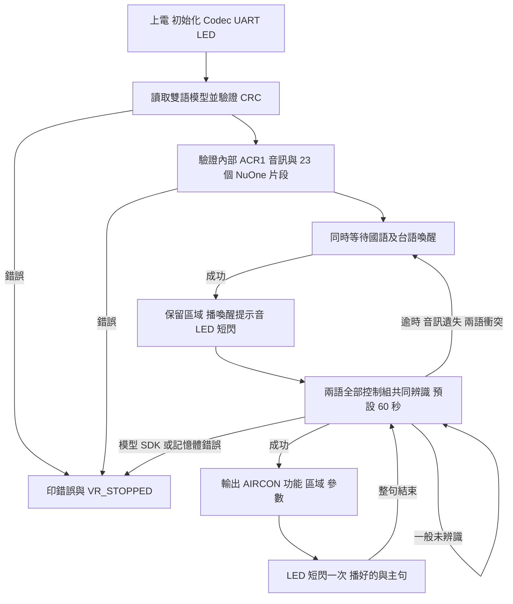
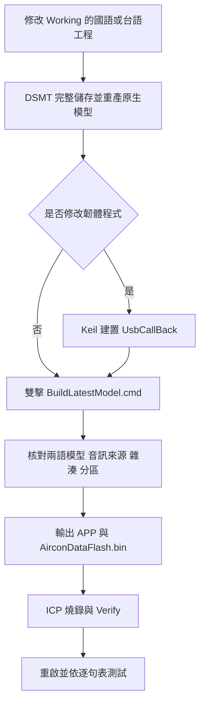

# Panasonic 冷氣國台語語音專案操作手冊

本專案使用 I94124 範例板卡、NAU88C22 與 DSpotter，同時辨識國語及台語。辨識成功時透過 UART 輸出功能、區域及參數，播放國語回覆並讓 PB0／D4 LED 短閃。

目前發布目錄為 **`CMDSet/ReleaseV005/`**。回覆音訊採 **16 kHz、NuOne 1.0 bits/sample**，存放於 MCU 內部 Flash。國語與台語命令共用同一套國語回覆；溫度設定回覆「好的，溫度已設定」，定時設定回覆「好的，定時已設定」，數值由 UART 核對。實際冷氣控制介面由應用層串接。

## 操作入口

| 工作 | 入口 |
|---|---|
| GitHub 上傳 | [GITHUB_UPLOAD.md](GITHUB_UPLOAD.md)，公開倉庫名稱 `I94100BSP_VR_DSpotter` |
| 燒錄 V005 | [ProgrammingLayout.txt](CMDSet/ReleaseV005/ProgrammingLayout.txt)；APROM 選 `DNN_NuOne_UAC.bin`，DataFlash 選 `AirconDataFlash.bin` |
| 修改國語模型 | [PanasonicAirConZHTW.dsmt](DSMT/Combine/Working/ChineseTWN/PanasonicAirConZHTW.dsmt) |
| 修改台語模型 | [Taiwanese.dsmt](DSMT/Combine/Working/Taiwanese/Taiwanese.dsmt) |
| 產生最新發布檔 | 雙擊根目錄 [BuildLatestModel.cmd](BuildLatestModel.cmd)，封裝本身不需 Python 或 Keil |
| 查詢兩語命令、MapID 與回覆 | [CommandMapIDQuickReference.md](DSMT/Test/CommandMapIDQuickReference.md) |
| 逐句測試 | [UserCommandTestGuide.txt](DSMT/Test/UserCommandTestGuide.txt)，含 137 個案例及全部喚醒／命令組合 |
| 修改回覆文字及音訊索引 | [ReplyProfile.json](AudioRes/ReplyPhrases/ReplyProfile.json) |
| 製作回覆 WAV | [GenerateReplyAudio.cmd](AudioRes/GenerateReplyAudio.cmd) |
| 編碼回覆音訊 | [AirconReplies.wba](AudioRes/ReplyPhrases/AirconReplies.wba)，由 Nuvoton Audio Tool 開啟 |
| 建置韌體 | [I94_Cyberon.uvproj](Prj/KEIL/I94_Cyberon.uvproj)，Target：`UsbCallBack` |
| 查詢封裝錯誤 | `DSMT/Test/BundleBuild_*.log`；處理方式見「常見問題與修改位置」 |

### 快速開始

1. 依「如何燒錄 V005」更新 APROM 與 DataFlash。
2. UART 設為 `115200 8N1`，重啟後確認 `[APP] release=V005`、`[AUDIO_READY]` 與 `[VR_READY] languages=2`。
3. 用國語說「房間冷氣」，等喚醒提示音結束，再說「開機」。
4. 核對 `map_id=1 command=POWER_ON`，聽到「好的，為您開機」，並確認 LED 短閃。
5. 等整句播完，改用台語說「設定二十八度」；UART 為 `map_id=128 value=28 unit=C`，回覆「好的，溫度已設定」。
6. 依逐句測試表繼續測試。同一控制階段可交替使用兩語。

## 下載專案與工具需求

下載或 clone 完整倉庫後，先閱讀 [ProgrammingLayout.txt](CMDSet/ReleaseV005/ProgrammingLayout.txt)；修改模型或程式時依下表選用工具。

| 工作 | 工具與來源 |
|---|---|
| 直接燒錄 V005 | Nuvoton ICP／Nu-Link；使用 `CMDSet/ReleaseV005/` 的 APROM 與 DataFlash |
| 修改命令、發音及產生模型 | Cyberon DSMT V2 與可用帳號；工程位於 `DSMT/Combine/Working/` |
| 一鍵更新模型發布檔 | Windows 與 .NET Framework；執行 `BuildLatestModel.cmd`，使用隨附 exe |
| 修改韌體 | Keil µVision、Arm Compiler 6、Nuvoton 裝置／Nu-Link 支援；工程為 `Prj/KEIL/I94_Cyberon.uvproj`，Target `UsbCallBack` |
| 修改需求 Excel、產生需求及測試文件 | Excel 相容編輯器與 Python 3；產生器使用 Python 標準函式庫 |
| 重新產生回覆音訊 | Windows 台灣國語聲音與 Nuvoton Audio Tool；流程見音訊維護章節 |

來源需求表為 [Panasonic_AirCon_Full_VoiceCommands.xlsx](DSMT/Input/Panasonic_AirCon_Full_VoiceCommands.xlsx)。檔案放置在專案內，需求產生器預設使用此檔案。

| 目錄 | 內容 |
|---|---|
| `DNN_VR/`、`Play/`、`Src/`、`Lib/`、`SH_Audio/` | 辨識、回覆播放、應用程式與 BSP |
| `Prj/KEIL/` | 韌體工程與記憶體配置 |
| `DSMT/Combine/Working/` | 國語、台語正式原生工程及模型 |
| `DSMT/Input/` | 來源 Excel、分類文字與 MapID 需求清單 |
| `DSMT/Test/` | 逐句測試手冊、MapID 速查表及主機測試原始碼 |
| `AudioRes/ReplyPhrases/` | 回覆定義、WAV、NuOne 工程與封裝所需產物 |
| `CMDSet/ReleaseV005/` | 目前版本的燒錄檔與發布指紋 |

Keil `obj/`、備份 `_Archive/`、本機燒錄設定及測試執行紀錄由 `.gitignore` 排除。下載後可直接使用 V005 燒錄檔；僅修改模型時，封裝工具會核對並沿用發布目錄內的韌體。修改韌體後，先使用 Keil 重新建置，再封裝。

第三方元件與授權說明見 [THIRD_PARTY_NOTICES.md](THIRD_PARTY_NOTICES.md)。

## 支援項目與硬體介面

| 項目 | 設定 |
|---|---|
| 語言 | 國語 `Chinese(TWN)`、台語 `Taiwanese`，同時辨識 |
| 國語詞條 | 84 種文字、9 個群組 |
| 台語詞條 | 53 種文字、215 筆發音候選、9 個群組 |
| 溫度 | 16～30 度，以 1 度為單位；支援升高、降低及指定溫度 |
| 定時 | 1～12 小時，以 1 小時為單位；支援取消定時 |
| nanoe | 兩語產品名稱均讀「奈諾伊」（nano-E） |
| 控制等待時間 | 預設 60 秒，可修改 `AIRCON_CONTROL_TIMEOUT_SECONDS` |
| 回覆 | 喚醒提示音＋21 種控制主句，共用「好的，」，共 23 個儲存片段 |
| 控制輸出 | UART 請求；GPIO、冷氣通訊、實際定時、音量及靜音狀態由應用層實作 |

| 介面 | 腳位／設定 | 用途 |
|---|---|---|
| UART0 | PB8 TX、PB9 RX；115200 8N1 | 辨識結果及系統紀錄 |
| LED | PB0／D4，低電位點亮 | 每次接受喚醒或命令短閃；顏色依板卡 |
| I²C1 | PD0 SCL、PD1 SDA；位址 0x1A | NAU88C22 設定 |
| I²S0 | PD2 MCLK、PD3 LRCK、PD4 DI、PD5 DO、PD6 BCLK | Codec 音訊；PD5 為播放資料 |

麥克風、Codec 與喇叭沿用範例硬體。V005 的回覆使用內部 Flash；外接音訊 Flash 可保留原內容，播放不需重新燒錄外接 Flash。

## 執行流程



整句播放期間暫停辨識；「好的，」與主句之間保留 120 ms 停頓，播放結束後重新開始控制視窗。控制逾時返回等待喚醒，MCU 與麥克風持續運作。

## DSMT 如何設定及操作

官方參考：[DSMT V2 操作指南](https://tool.cyberon.com.tw/DSMT_V2/index.php?lang=en)、[音素表](https://tool.cyberon.com.tw/DSMT_V2/phoneme.php?lang=en)。

### 載入目前工程

1. 開啟 DSpotter Modeling Tool V2，登入帳號。
2. 選「檔案 → 載入專案」，開啟操作入口列出的國語或台語 `.dsmt`。
3. 核對語言：國語為 `Chinese(TWN)`，台語為 `Taiwanese`。兩語各自使用其工程內的 `CYBase.mod`。
4. 核對模型設定：16 kHz、23d、100 fps、Level 1、32-bit、小端序、4-byte alignment。
5. 核對下列 9 個群組；每組均需有詞條，第一組為喚醒組。

| 群組 | 內容 | 啟用階段 |
|---|---|---|
| Group_1_Wake | 喚醒與區域 | 等待喚醒 |
| Group_2_Power | 電源 | 控制 |
| Group_3_Mode | 冷氣、暖氣、除濕、自動 | 控制 |
| Group_4_Temperature | 升降與 16～30 度 | 控制 |
| Group_5_Fan | 風量 | 控制 |
| Group_6_Swing | 風向 | 控制 |
| Group_7_Health | nanoe | 控制 |
| Group_8_Volume | 音量與靜音請求 | 控制 |
| Group_9_Timer | 1～12 小時與取消 | 控制 |

### 新增或修改詞條

| 修改內容 | 操作流程 | 需同步的資料 |
|---|---|---|
| 同功能增加說法，例如「開啟冷氣」 | A 新增同功能別名 | Excel、需求清單、DSMT 模型及測項 |
| 文字相同，調整發音或辨識參數 | B 調整既有詞條 | DSMT 模型及測項 |
| 多句話輸出相同功能 | C 共用 MapID | 依新增別名或調整發音的流程處理 |
| 新增功能、區域或擴大數字範圍 | D 新增功能 | 需求、模型、韌體解碼及測項 |

#### 操作前準備

1. 從 `DSMT/Input/MapID_Reference.txt` 查詢目標詞條的語言、分類、MapID、功能及參數。MapID 是功能識別碼，與畫面列號及群組編號分開使用。
2. 儲存並關閉 DSMT 工程。將兩語完整 `Working` 資料夾、`DSMT/Input`、相關腳本、發布檔及已填測試表備份至 `_Archive/`。工程備份包含 `.dsmt`、`CYBase.mod`、群組模型及設定檔。
3. 新增或改名詞條時，先依「需求同步」更新來源清單，再進行 DSMT 編輯。僅調整既有詞條的音素或辨識參數時，可直接操作 DSMT。
4. 以下命令均在專案根目錄執行；圖形介面操作使用 `DSMT/Combine/Working/` 內的對應語言工程。

#### A 新增同功能別名

以下以新增國語「開啟冷氣」、沿用 `MapID=1` 的 `POWER_ON` 為例。

1. 在來源 Excel 的 B3 追加 ` / 開啟冷氣`，依「需求同步」更新並產生清單。
2. 載入 `DSMT/Combine/Working/ChineseTWN/PanasonicAirConZHTW.dsmt`。
3. 切換至 `Group_2_Power`。
4. 在新增命令欄輸入 `開啟冷氣`，按「新增／Add」或 Enter。
5. 選取新增列，按「修改／Edit」，將 `CmdMapID` 設為 `1`。
6. 檢查音素並按「播音／Play」確認讀音；需要修正時依流程 B 操作。
7. 儲存工程，等待「所有修改皆已儲存」。
8. 重新載入同一 `.dsmt`，核對新詞、分類、發音及 `CmdMapID=1`。
9. 依「DSMT改完後取得最新bin」封裝，再依燒錄流程更新模型。
10. 測試「房間冷氣 → 等提示音 → 開啟冷氣」，預期 UART 為 `map_id=1 command=POWER_ON`；原有電源詞條也列入測試。

多筆新增可將新增文字以一行一詞存成 UTF-16LE 檔，在對應群組使用「批次新增／Batch Add」，再逐列設定 MapID 與發音。`DSMT/Input/<語言>/Group_*.txt` 是該組完整清單；`All.Core.txt` 是排除 nanoe 的匯入清單。將完整清單再次匯入已有詞條的群組前，需核對重複項目。

#### B 調整既有詞條

**發音調整**

1. 載入對應語言工程，選取分類與詞條，記錄原音素及 MapID。
2. 按「播音／Play」，對照目標讀法。
3. 在下方「指令發音」欄修改音素，按「更新／Update」，由 DSMT 產生有效的音素 ID 與 IPA。
4. 再次播音，核對整句音節、聲調與斷句。
5. 保持原文字、分類及 MapID，儲存工程後重新載入確認。
6. 封裝、燒錄，測試修改詞條、同組近音詞及跨語言命令。

同一文字可有多筆原生發音候選。畫面中的 `^1`、`^2` 為候選索引，口說時讀命令本身；Excel 也使用原命令文字。調整讀音時選取對應候選列，其他候選可分別維護。另一句自然說法則依流程 A 登記為別名，沿用相同功能的 MapID。

**台語「溫度攑懸」設定**

1. 在台語工程開啟 `Group_4_Temperature`，選取「溫度攑懸」，MapID 為 `7`。
2. 「指令發音」使用 `<zh-NAN>un7.too7.gia3.kuan5`；本專案的「攑」採第三調低降 `gia3`。
3. 按「更新」、播音、儲存並重新載入確認，再封裝模型。
4. 依測試表 T013 測試，預期 `map_id=7 command=TEMP_UP`。

`giah8` 與 `gia3` 的拼法及尾音不同；此處使用的第三調為台語聲調。其他詞條依所選語言的 DSMT 音素表設定。

**修改顯示文字或整句內容**

「修改／Edit」中的 Rename 只變更顯示文字，既有發音會保留。變更整句時，先同步 Excel 與需求清單，再更新新句的完整發音及 MapID。產品名稱可保留 `nanoe` 顯示文字，讀音另設為「奈諾伊」。

**辨識參數調整**

1. 確認詞條已建模，且測試時已喚醒、位於控制視窗內、提示音已播完。
2. 記錄測試距離、環境、口說內容與 UART 結果，作為比較基準。
3. 在所選詞條一次調整一項參數，例如 `Confi. Reward`、`SG Diff. Reward`、`Extra Ending` 或快速語音設定，再儲存及重產模型。
4. 比較目標詞、近音詞、背景對話及國台語交叉辨識。辨識獎勵與快速語音設定會影響漏辨及誤觸發；結尾等待會影響回應時間。
5. 整組 Global 設定適用於群組內所有詞條；調整後測試該組完整清單。

#### C 共用 MapID

同一 MapID 對應相同功能、參數及單位。不同語言與不同說法可共用；指定不同溫度或小時數時使用各自的 MapID。

| 語言／說法 | MapID | 輸出 |
|---|---|---|
| 國語「開機／開冷氣／開空調」 | 1 | `POWER_ON` |
| 台語「開冷氣／打開冷氣」 | 1 | `POWER_ON` |
| 國語、台語「設定二十八度」 | 128 | `TEMP_SET value=28 unit=C` |
| 國語、台語「設定十八度」 | 118 | `TEMP_SET value=18 unit=C` |

| ID 範圍 | 定義 |
|---|---|
| 1～19 | 固定功能，完整對照見文末回覆清單及 `MapID_Reference.txt` |
| 116～130 | 指定溫度，`MapID = 100 + 度數` |
| 201～212 | 定時關機，`MapID = 200 + 小時` |
| 1001 | 房間喚醒，`zone=ROOM` |
| 1002 | 客廳喚醒，`zone=LIVING` |
| 1003 | 全域喚醒，`zone=GLOBAL`；國語「國際冷氣」 |

國語及台語別名分別建立於各自工程。喚醒別名放在 `Group_1_Wake`，新增文字時同步 `WAKE_IDS`；控制別名放在對應功能組。韌體將同一輪兩語的相同 MapID 結果合併。

#### 需求同步

來源檔為 `Panasonic_AirCon_Full_VoiceCommands.xlsx`，工作表為「完整語音指令與回覆」。A 欄分類、B 欄國語、C 欄台語、D 欄回覆、E 欄功能說明。

需求產生器 `DSMT/build_command_inputs.py` 使用固定 Excel 列號與統計值；新增、刪除或改名詞條時，需同步來源及相關設定。這項維護工作使用 Python；既有詞條的發音調整及一鍵封裝使用 DSMT 與已附 exe 即可。

1. **固定命令別名**：在 B／C 欄對應儲存格以 ` / ` 分隔。例如 B3 為 `開機 / 開冷氣 / 開空調 / 開啟冷氣`。
2. **溫度及定時句型**：B11／C11、B22／C22 提供需求說明，實際數字詞條由 `build_records()` 展開。增加句型時，在該函式設定語言、文字、MapID、`value` 及 `unit`。
3. **喚醒別名**：B2／C2 更新後，在 `WAKE_IDS` 登記新文字的區域 ID 與 zone。
4. **分類及筆數**：依實際差異更新 `validate()` 的語言／階段筆數、九分類筆數及總需求數；有新增語意時同步唯一 MapID 數，並更新 `main()` 的統計訊息。

   | 只新增一個國語電源別名的範例 | 原值 | 更新值 |
   |---|---|---|
   | 國語 wake／control | 3／81 | 3／82 |
   | 國語九分類筆數 | `(3,6,8,21,7,4,4,6,25)` | `(3,7,8,21,7,4,4,6,25)` |
   | 總需求文字／唯一 MapID | 137／49 | 138／49 |
   | 國語文字小計 | 84 | 85 |
   | `main()` 的國語 control／core | 81／77 | 82／78 |

   此例的台語計數保持 2 個喚醒、51 個控制。需求文字數與發音候選列數分別統計。

5. 來源 Excel 為 [Panasonic_AirCon_Full_VoiceCommands.xlsx](DSMT/Input/Panasonic_AirCon_Full_VoiceCommands.xlsx)。儲存後，在專案根目錄執行下列命令；使用其他 Excel 時，可加上 `--workbook "<來源 Excel 路徑>"`：

   ```powershell
   python -B -X utf8 DSMT\build_command_inputs.py
   ```

6. 核對來源與產物差異後，加入 `--replace-generated` 更新輸入檔：

   ```powershell
   python -B -X utf8 DSMT\build_command_inputs.py --replace-generated
   ```

7. 產物位於 `DSMT/Input/`：`CommandManifest.json`、`MapID_Reference.txt` 及兩語分類文字檔。核對新詞的 `language`、`group`、`map_id`、`command`、`source_cell`，再依流程 A／B 建立 DSMT 模型。
8. 更新 `DSMT/build_user_docs.py` 的版本及統計說明，包括 `load_context("ReleaseV005")`、`render_guide()` 的發布路徑／需求小計／群組數，以及 `main()` 的統計。備份已填測試表後，執行：

   ```powershell
   python -B -X utf8 DSMT\build_user_docs.py --replace-generated
   ```

   產物為 `DSMT/Test/UserCommandTestGuide.txt` 與 `DSMT/Test/CommandMapIDQuickReference.md`；逐句表的測試結果欄重新建立為未測狀態。

#### D 新增功能或擴充參數範圍

1. 定義新功能、合法參數、分類、兩語說法、回覆句及 MapID。
2. 更新 Excel 與 `DSMT/build_command_inputs.py` 內受影響的 `FIXED_ROWS`、`GROUPS`、`WAKE_IDS`、`build_records()` 及驗證筆數。插入 Excel 新列時一併更新列號對照。
3. 在 `DNN_VR/AirconCommands.c` 的 `AirconCommands_Decode()` 加入功能解碼；新增區域時更新 `AirconCommands_Zone()`，並同步相關標頭及呼叫處。
4. 更新 `DSMT/Test/test_aircon.c` 及測試表產生器。調整數字範圍時，同步合法邊界與非法值測項。
5. 在 DSMT 建立模型；群組結構改變時，核對引擎支援、記憶體及群組啟用設定。
6. 依序完成 Keil Rebuild、封裝、主機檢查、燒錄與板測。實際冷氣介面可在應用層接收解碼結果後加入。

### nanoe 設定

顯示名稱沿用 Excel 的 `nanoe`，兩語口說均讀「奈諾伊」。

| 語言 | 顯示命令 | MapID | 音素設定 |
|---|---|---|---|
| 國語 | 開 nanoe／啟動 nanoe | 14 | 產品名讀音為 `nai4.nuo4.yi1` |
| 國語 | 關 nanoe／關閉 nanoe | 15 | 產品名讀音為 `nai4.nuo4.yi1` |
| 台語 | 開 nanoe | 14 | `<zh-NAN>khui7.nai3.noo3.i1` |
| 台語 | 關 nanoe | 15 | `<zh-NAN>kuainn7.nai3.noo3.i1` |

建立品牌讀音時，可先輸入「奈諾伊」產生有效發音，再保留讀音修改顯示名稱。按「更新」、播音、儲存並重新載入後，核對文字及 MapID。國語及台語各使用對應語言的音素表。

### 重整分類與封裝

在既有群組內新增或調整詞條後，可直接儲存並封裝。需要批次重整分類時，使用下列維護流程；此工具需 Python。

1. 儲存並關閉 DSMT 工程。
2. 執行檢查命令，將引號內替換為對應 `.dsmt` 路徑：

   ```powershell
   python -B -X utf8 DSMT\regroup_native_project.py "<工程.dsmt>"
   ```

3. 核對分類結果，加入 `--apply` 執行。工具先備份至 `_Archive/`，再重整分類並移除待重建的舊模型產物。
4. 在 DSMT 重新載入工程，儲存並產生模型，再重新載入確認。
5. 依下一節執行一鍵封裝。`Unknown word; preserve and review` 表示需求清單缺少該詞，處理位置為 Excel 與 `DSMT/Input/CommandManifest.json` 的產生流程。

### DSMT改完後取得最新bin：操作入口

雙擊 [BuildLatestModel.cmd](BuildLatestModel.cmd)，產物位於 **`CMDSet/ReleaseV005/`**。工具使用已附的 `DSMT/AirconBundleBuilder.exe`，需要 Windows 的 .NET Framework 4.5 以上系統元件；封裝本身不呼叫 Python、PowerShell、DSMT 或 Keil。



1. 在正式 `DSMT/Combine/Working/` 工程修改並儲存，等到「所有修改皆已儲存」。新增或改名詞條時先完成需求同步。
2. 重新載入 `.dsmt`，核對詞條、發音及 MapID。原生 `.mod/.txt/_pack.bin` 應來自同次儲存。
3. 如有 C 程式修改，先完成 Keil 建置。
4. 雙擊 `BuildLatestModel.cmd`，或在專案根目錄執行：

   ```powershell
   .\BuildLatestModel.cmd
   ```

5. 等待 `SUCCESS`，核對輸出路徑與 `ModelManifest.json`。紀錄位於 `DSMT/Test/BundleBuild_*.log`。
6. 首次使用 V005 時燒錄 APP 與 `AirconDataFlash.bin`。板上已使用相容 V005 韌體，且僅修改語音時，可只更新 DataFlash 整合檔。
7. 執行 ICP Verify，重啟後測修改詞條、同組近音詞及國台語交叉組合。

| 產物 | 用途 |
|---|---|
| `DNN_NuOne_UAC.bin` | APROM 韌體，起點 `0x0` |
| `AirconDataFlash.bin` | 模型＋內部音訊的整合燒錄檔，起點 `0x15000` |
| `AirconModels.bundle.bin` | ACB1 雙語模型組件，供核對及進階單獨更新 |
| `AirconReplies.bin` | ACR1 回覆音訊組件，位於 `0x70000` |
| `ChineseTWN.pack.bin`、`Taiwanese.pack.bin` | 單語模型副本 |
| `ModelManifest.json` | 位址、來源、大小及 SHA-256 |

`AirconDataFlash.bin` 在模型與音訊之間以 `0xFF` 補齊。一般 ICP 操作使用這個整合檔，即可一次更新模型與音訊。

### 兩份 DNN_NuOne_UAC.bin 的用途

| 位置 | 產生方式 | 更新時機 |
|---|---|---|
| `Prj/KEIL/obj/DNN_NuOne_UAC.bin` | Keil After Build 使用 `fromelf --bin` | 本機建置成功後 |
| `CMDSet/ReleaseV005/DNN_NuOne_UAC.bin` | 封裝工具複製的發布副本 | 執行一鍵封裝後 |

韌體預設取自 Keil `obj`。該檔不存在時，工具使用經原 Manifest 雜湊驗證的 V005 發布韌體。修改程式後依序執行 **Keil 建置 → 一鍵封裝 → 燒錄**。

```powershell
Get-FileHash -Algorithm SHA256 -LiteralPath '.\Prj\KEIL\obj\DNN_NuOne_UAC.bin','.\CMDSet\ReleaseV005\DNN_NuOne_UAC.bin'
```

### 發布及工具維護

發布內容有變動時，工具先驗證並備份原發布目錄的頂層檔案至 `_Archive/ModelBundleBefore_*.zip`，再更新產物；內容相同時保留原檔。工程、來源錄音及已填測試表另行備份。

```powershell
.\BuildLatestModel.cmd --no-pause
.\BuildLatestModel.cmd --output CMDSet\ModelCandidate
.\BuildLatestModel.cmd --firmware CMDSet\ReleaseV005\DNN_NuOne_UAC.bin
```

相對路徑以專案根目錄為準，輸出位於 `CMDSet/` 內。指定輸出資料夾僅改變封裝目的地；韌體版本與音訊格式仍依實際來源。

| 維護檔案 | 用途 |
|---|---|
| `DSMT/AirconBundleBuilder.cs`、`build_bundle_tool.cmd` | 封裝工具原始碼及重新編譯入口 |
| `DSMT/build_model_bundle.py`、`build_reply_audio.py` | Python 參考實作與音訊結構核對 |
| `DSMT/Test/run_host_tests.cmd` | 解碼、CRC、播放佇列與控制流程主機測試，需要 Visual Studio C 工具 |
| `DSMT/Test/test_bundle_builder.py` | 封裝一致性與錯誤處理測試，需要 Python |

## Keil 如何建置

1. 開啟 `Prj/KEIL/I94_Cyberon.uvproj`，Target 選 `UsbCallBack`。
2. 使用專案 SDK `2.2.25.2`、Arm Compiler 6.22 及原板卡設定。
3. 執行 Rebuild，確認沒有 error，並檢查 `Prj/KEIL/obj/DNN_NuOne_UAC.bin` 已產生。
4. `Prj/KEIL/Aircon.sct` 將韌體配置在 `0x15000` 之前，並保留 NuOne 固定 RW 區域；容量及記憶體配置改動時同步檢查此檔。
5. 執行 `BuildLatestModel.cmd`，將新韌體與雙語模型封裝至發布目錄，再依下節燒錄。

### 修改控制等待時間

1. 開啟 `DNN_VR/AirconVR.h`，修改下列設定，單位為整數秒：

   ```c
   #ifndef AIRCON_CONTROL_TIMEOUT_SECONDS
   #define AIRCON_CONTROL_TIMEOUT_SECONDS 60U
   #endif
   ```

2. 重新建置韌體、執行一鍵封裝，再燒錄韌體；DSMT 模型可沿用。
3. 每個辨識區塊為 480 samples／16 kHz，即 30 ms。程式向上換算 frame 數，60 秒對應 2000 frames。
4. 重啟後核對 UART 的 `[VR_CONFIG] control_timeout_s=60 control_timeout_frames=2000`。
5. 喚醒後分別在第 30、55 秒說命令；另測安靜至逾時的 `[VR_TIMEOUT]`，以及成功命令後重新計時的行為。

## 如何燒錄 V005

首次使用 V005，更新下列兩個檔案。板上已使用相容 V005 韌體，僅調整辨識詞或回覆音訊時，可只更新 DataFlash。

| ICP 欄位 | 起始位址 | 選擇檔案 |
|---|---|---|
| APROM | `0x00000000` | `CMDSet/ReleaseV005/DNN_NuOne_UAC.bin` |
| DataFlash | `0x00015000` | `CMDSet/ReleaseV005/AirconDataFlash.bin` |

1. 連接 I94124 板卡，沿用範例麥克風、NAU88C22 與喇叭配置。
2. 開啟 NuMicro ICP，選擇裝置與連線，核對板卡 Config，DataFlash 起點為 `0x15000`。
3. APROM 與 DataFlash 分別選擇上表檔案。載入既有 `.icp` 取用板卡設定後，重新指定發布檔；原 `.icp` 內含範例資料。
4. 依 `ModelManifest.json` 核對大小及 SHA-256，執行燒錄與 Verify。
5. 外接 SPI Flash 可保留原內容；V005 的回覆由內部 Flash 播放。
6. 重啟並保存 UART，確認以下資訊：

   ```text
   [APP] release=V005 feedback=full_reply_led led=PB0 audio=internal
   [AUDIO_READY] address=0x00070000 rom_bytes=59934 clips=23 bps=1.0
   [VR_CONFIG] control_timeout_s=60 control_timeout_frames=2000
   [MODEL] language=ZHTW groups=9 controls=8
   [MODEL] language=TAIWANESE groups=9 controls=8
   [VR_READY] languages=2 pool=102400 uart=115200
   ```

7. 依下節測試喚醒、完整回覆、LED、UART 及接續命令。回復版本時使用該版相容的 APP 與 DataFlash 資料。

進階組件位址為雙語模型 `0x15000`、回覆音訊 `0x70000`。`AirconReplies.bin` 包含 ACR1 標頭；Nuvoton 工具產生的原生 `.ROM` 由封裝工具包裝後使用。

## 如何測試 語音回覆 LED UART

### 基本測試

1. UART0 設 `115200 8N1`，PB8 TX／PB9 RX，從重啟開始保存 log。
2. 等 `[VR_READY]`，用國語說「房間冷氣」。核對 `[WAKE] zone=ROOM map_id=1001`、喚醒提示音與 LED 短閃。
3. 等提示音播完，說「開機」。UART 應有 `map_id=1 category=Power command=POWER_ON`，並播放「好的，為您開機」。
4. 核對 `[AUDIO_REPLY] map_id=1 count=2 first=1 last=2`。LED 每次接受結果短閃一次，兩段語音之間保留 120 ms 停頓。
5. 等完整回覆播完，用台語說「設定二十八度」。UART 應為 `map_id=128 command=TEMP_SET value=28 unit=C`，語音為「好的，溫度已設定」。
6. 測「兩小時後關機」，核對 `map_id=202 command=TIMER_OFF value=2 unit=h`，語音為「好的，定時已設定」。
7. 同一控制階段接續說不同語言命令；成功回覆結束後重新開始 60 秒等待。

冷氣實際控制介面另行串接。電源、溫度、定時、音量及靜音命令目前輸出 UART 請求；回覆播放由辨識結果觸發。

### 未辨識或誤辨後的操作

| 結果 | 目前階段 | 下一步 |
|---|---|---|
| 無結果、一般拒絕辨識，尚未逾時 | 控制 | 直接重說命令 |
| 有 `[AIRCON]`，但功能或數字錯誤 | 控制 | 記錄為誤辨，等整句回覆播完後重說 |
| `[VR_ERROR] code=-1106` | 等待喚醒 | 重新說喚醒詞，等提示音，再說命令 |
| `[VR_ERROR] code=-1105` | 等待喚醒 | 重新喚醒；持續發生時檢查音訊遺失及處理時間 |
| `[VR_TIMEOUT]` | 等待喚醒 | 重新說喚醒詞 |
| `[VR_STOPPED]` | 停止辨識 | 保存錯誤、處理原因後重啟 |

`-1106` 表示兩語引擎回傳不同 MapID，該次不輸出控制命令，程式會清除區域並返回等待喚醒。`drops=0` 表示該輪沒有音訊 frame 遺失。相關處理位於 `DNN_VR/AirconVR.c` 與 `Src/app/src/main.c`。

### 完整逐句測試

1. 開啟 [UserCommandTestGuide.txt](DSMT/Test/UserCommandTestGuide.txt)。國語為 Z001～Z084，台語為 T001～T053，每列都有預期 MapID、UART、國語回覆及台語發音提示。
2. 每個獨立案例依序操作：**Reset → VR_READY → 指定喚醒 → 等提示音 → 指定命令 → 核對 UART／完整回覆／LED**。
3. 每列記錄三次結果：`N` 未測、`P` 正確、`M` 漏辨、`W` 誤辨、`E` 系統錯誤；`NA` 用於尚無模型的項目。
4. 依表完成 137 個需求案例、660 組喚醒×命令組合及 11 個控制／播放流程案例。
5. 溫度逐度測 16～30 度，定時逐小時測 1～12 小時。共用回覆不含數字，各項仍需核對 UART 的 `value`。
6. 核對「好的，」與主句順序、停頓、完整結尾、一次 LED 短閃，以及回覆後立即接續命令的辨識。
7. 保存說話者、距離、環境與 UART。兩語並列查詢見 [MapID 速查表](DSMT/Test/CommandMapIDQuickReference.md)。

### nanoe 與台語聲調測項

每組先 Reset、等 `[VR_READY]`，說喚醒詞並等提示音播完，再說命令。

| 喚醒 | 命令語言／讀法 | 預期結果 |
|---|---|---|
| 台語「房間冷氣」 | 台語「開奈諾伊」 | `map_id=14 command=NANOE_ON`，國語回覆開啟奈諾伊 |
| 台語「房間冷氣」 | 台語「關奈諾伊」 | `map_id=15 command=NANOE_OFF`，國語回覆關閉奈諾伊 |
| 國語「房間冷氣」 | 台語「開奈諾伊」 | `map_id=14`，同功能回覆 |
| 台語「房間冷氣」 | 國語「關奈諾伊」 | `map_id=15`，同功能回覆 |
| 台語「房間冷氣」 | 台語「溫度攑懸」，攑讀 `gia3` | `map_id=7 command=TEMP_UP`，回覆溫度已調高 |

完整讀音見 T013、T036／T037 及各項候選。ASR 發音修改依 DSMT 流程 B；回覆讀稿修改位置為 `ReplyProfile.json`。

### 記憶體與音訊檢查

保存 `[VR_MEMORY] stage=0`（喚醒）及 `stage=1`（控制）。辨識池為 102400 bytes，兩語 SDK 需求合計需在此範圍內。新增詞條或群組後，量測 RAM、stack、即時處理時間及遺失 frame。

回覆沿用 NuOne 解碼器與 PDMA 緩衝區；整句播放期間暫停辨識，播放結束後辨識器清除舊音訊 frame。聲學準確率、音量、回音與實際播放銜接依板測記錄確認。

## 常見問題與修改位置

| 現象／訊息 | 檢查位置 | 處理方式 |
|---|---|---|
| DSMT 載入失敗 | `DSMT/Combine/Working/<語言>/` | 載入對應語言原生 `.dsmt`，核對 CYBase、群組模型及設定檔 |
| 文字正確但讀音不符 | DSMT「指令發音」欄 | 更新音素、播音、儲存，重產模型後封裝 |
| Rename 後仍讀原句 | DSMT「修改／Edit」 | 更新新句完整發音，並同步需求清單 |
| `Unknown word/category`／MapID 不符 | Excel、需求產生器、`CmdMapID` | 同步文字、分類、ID 與計數，再完整儲存 DSMT |
| `Unexpected count`／`Unexpected category count` | `build_command_inputs.py` | 核對重複文字及新增／刪除筆數，更新對應統計 |
| `Saved text does not match`／`Native pack components mismatch` | Working 工程與匯出檔 | 在 DSMT 完整儲存並重產原生模型 |
| `Audio source changed` | `AudioBuildManifest.json` 與回覆來源 | 完成 WAV 製作、Audio Tool 建置及 `SealAudioBuild.cmd`，再封裝 |
| `Source is newer than the encoded ROM` | WAV、UID 與工具輸出 | 在 Audio Tool 執行 F7，再執行來源核對 |
| `Preserve changed recording` | WAV 與 `PhraseSourceManifest.json` | 保留自訂錄音，另選輸出目錄；核對來源及指紋後再建置 |
| 缺少 exe 或 .NET 元件 | `DSMT/`、Windows 系統元件 | 保留隨專案提供的 exe，確認 .NET Framework 4.5 以上環境 |
| `V005 firmware ... required` | Keil `obj`／指定韌體 | 使用本專案 V005 韌體，或重新建置 |
| `Preserve changed output` | 發布檔與 ModelManifest | 另存被修改檔案並核對差異，需要獨立輸出時指定新目錄 |
| `Another builder` | 同一發布目錄的封裝作業 | 等目前作業完成後重跑 |
| 開機 `[MODEL_ERROR]` | ICP DataFlash 檔案及位址 | 以 `AirconDataFlash.bin` 寫入 `0x15000` 並 Verify |
| 開機 `[AUDIO_ERROR] code=-1201..-1205` | 音訊標頭、CRC、索引及格式 | 核對 V005 發布檔，重新燒錄 DataFlash 整合檔並 Verify |
| 有短提示音但沒有控制主句 | `[APP]`、所選 APP 與 DataFlash | 確認為 V005，更新 APROM 及 DataFlash 整合檔 |
| `[FEEDBACK_ERROR] reason=audio_init`／`[AUDIO_ERROR] reason=decode` | 音訊檔、播放初始化及 Codec | 核對 16 kHz／1.0 音訊與版本，保存完整錯誤後測試 Codec 及喇叭 |
| `-1104`／`[VR_STOPPED]` | `[VR_MEMORY]`、模型及 SDK | 檢查辨識池、群組與初始化，處理後重啟 |
| `-1105`／`-1106` | 音訊遺失／兩語結果衝突 | 重新喚醒後續測；保留口說內容與 UART 供模型調整 |
| 有回覆但冷氣沒有動作 | `AirconCommands.c` 與應用層 | 依解碼結果串接 GPIO 或冷氣通訊介面 |

## 回覆音訊的設定與維護

23 個音訊片段包含喚醒提示音、共用「好的，」與 21 個功能主句，供 49 個 MapID 共用。數字仍保留於辨識結果與 UART；指定溫度及定時使用各自的一句共用回覆。

### MCU 內部 Flash 配置

1 KiB＝1024 bytes。以下數值依目前 V005 bin 與 Keil map；每次封裝後以 `ModelManifest.json` 核對實際產物。

| 區域 | 位址範圍 | 分配容量 | 實際使用 | 剩餘 |
|---|---|---:|---:|---:|
| APP 韌體 | `0x00000`～`0x14FFF` | 84 KiB | 74,328 bytes（72.59 KiB） | 11.41 KiB |
| 國語＋台語模型 | `0x15000`～`0x6FFFF` | 364 KiB | 336,108 bytes（328.23 KiB） | 35.77 KiB |
| 回覆音訊映像 | `0x70000`～`0x7FFFF` | 64 KiB | 59,952 bytes（58.55 KiB） | 5.45 KiB |
| 合計 | `0x00000`～`0x7FFFF` | 512 KiB | 459.36 KiB | 52.64 KiB |

APP 包含程式碼、唯讀資料及初始化 RW 資料；ZI Data 使用 RAM。回覆音訊原生 ROM 為 59,934 bytes，加入 ACR1 標頭與對齊後為 59,952 bytes。

`AirconDataFlash.bin` 從 `0x15000` 開始，將模型與 `0x70000` 的音訊一次寫入。模型後方、音訊之前的 `0xFF` 區域保留供模型擴充。

### 修改回覆文字與產生 WAV

1. 儲存並關閉 Audio Tool 專案。
2. 編輯 `AudioRes/ReplyPhrases/ReplyProfile.json` 的 `phrases[].text`。固定索引 0 為喚醒提示音，1 為「好的，」，2～20 為固定功能，21 為指定溫度，22 為定時設定。
3. 溫度與定時的整句定義同步 `reply_overrides.TEMP_SET`／`TIMER_OFF`，再執行需求產生器，使測試表與回覆定義一致；原 Excel D 欄保留來源原文。
4. 雙擊 `AudioRes/GenerateReplyAudio.cmd`，使用 Windows 台灣國語聲音產生 `AudioRes/ReplyPhrases/WavSrc/`。預設為 `Microsoft Hanhan Desktop`、語速 0。
5. 現有自動產生的來源未被更改時，工具先建立並核對 `_Archive/Before_ReplyWav_*.zip`，再重新產生。自訂錄音另存並維護來源清單；工具會保留與原指紋不同的錄音。
6. 試聽新 WAV，確認完整句、奈諾伊讀法及片語邊界。需要指定聲音或語速時，可在專案根目錄執行：

   ```powershell
   .\AudioRes\GenerateReplyAudio.cmd -VoiceName "Microsoft Hanhan Desktop" -Rate 0
   ```

WAV 為 16 kHz、16-bit、單聲道。產生器去除頭尾靜音並保留邊界緩衝；語音合成需要該電腦已安裝相應聲音。一般 DSMT 模型更新使用隨專案附帶的音訊產物即可。

### NuOne 1.0 編碼與封裝

1. 使用 Nuvoton Audio Tool 開啟 `AudioRes/ReplyPhrases/AirconReplies.wba`。本機工具位於 `C:\Nuvoton\NSPPlayListEditor\V3.01.000\NSP_SDS\SDS_NSP\AudioTool\AudioTool.exe`；其他電腦依實際安裝位置開啟。
2. 工程使用 `WavSrc/AirconReplies.uid`。各項定義包含 `format=NUO, bitrate=1.0`，順序對應 Profile 的索引。
3. 按 F7／Project → Build，確認 0 errors，輸出位於 `AudioRes/ReplyPhrases/Output/`。
4. 雙擊 `AudioRes/ReplyPhrases/SealAudioBuild.cmd`，核對 WAV、Profile、UID、編碼 ROM 與索引標頭，更新 `AudioBuildManifest.json`。
5. 若只改回覆讀稿且索引／MapID 不變，直接執行 `BuildLatestModel.cmd`。若改了索引、功能、播放程式或等待設定，先 Keil 建置。
6. 燒錄 V005 的 `AirconDataFlash.bin`，Verify 後重啟，逐句核對回覆及 UART。程式有修改時一併更新 APROM。


### 程式修改位置

| 檔案／位置 | 用途 |
|---|---|
| `DNN_VR/AirconAudio.c` | 音訊 CRC／格式核對、MapID→回覆索引 |
| `DNN_VR/AirconAudio.h` | 音訊位址、片段數及片語停頓 frame 數 |
| `Play/PlayNuOne.c` | 片語佇列、PDMA 雙緩衝銜接、內部 Flash 讀取 |
| `Src/app/src/main.c` | 解碼後 UART、LED 及回覆觸發 |
| `DSMT/AirconBundleBuilder.cs` | 模型／音訊界線、指紋、整合 DataFlash 與發布 |

新增真正的新功能時，同步解碼、Profile、回覆索引、封裝核對及主機測試。音訊位址變更時，一併更新韌體、封裝分區與燒錄說明。

## Excel 原始需求對照

下表保留 Excel 的分類、別名與原始 D 欄回覆。專案的溫度及定時設定回覆分別使用「好的，溫度已設定」與「好的，定時已設定」，定義於 `ReplyProfile.json`。每個數值的兩語說法與 MapID 見 [速查表](DSMT/Test/CommandMapIDQuickReference.md)。

| Excel列 | 分類 | MapID | 國語 B欄 | 台語 C欄 | 回覆 D欄 | 功能 E欄 |
| --- | --- | --- | --- | --- | --- | --- |
| 2 | 喚醒 | `1001` / `1002` / `1003` | 房間冷氣 / 客廳冷氣 / 國際冷氣 | 房間冷氣 / 客廳冷氣 | 「滴」一聲 (提示音) 或 「我在」 | 喚醒冷氣機（必須先說喚醒詞才能接續指令） |
| 3 | 電源 | `1` | 開機 / 開冷氣 / 開空調 | 開冷氣 / 打開冷氣 | 好的，為您開機 | 開啟空調電源 |
| 4 | 電源 | `2` | 關機 / 關冷氣 / 關空調 | 關冷氣 / 冷氣關起來 / 冷氣關掉 | 好的，為您關機 | 關閉空調電源 |
| 5 | 模式 | `3` | 舒適冷房 / 吹冷氣 | 吹冷氣 | 好的，切換冷氣模式 | 切換至冷氣模式 |
| 6 | 模式 | `4` | 舒適暖房 / 開暖氣 / 吹暖氣 | 吹暖氣 | 好的，切換暖氣模式 | 切換至暖氣模式 |
| 7 | 模式 | `5` | 開除濕 / 吹除濕 | 開除濕 | 好的，切換除濕模式 | 切換至除濕模式 |
| 8 | 模式 | `6` | 開自動 | 開自動 | 好的，切換自動模式 | 切換至自動模式 |
| 9 | 溫度 | `7` | 溫度調高 / 溫度高一點 / 太冷了 | 溫度調高 / 溫度攑懸 | 好的，溫度已調高 | 提高設定溫度1度 |
| 10 | 溫度 | `8` | 溫度調低 / 溫度低一點 / 太熱了 | 溫度調低 / 溫度降落 | 好的，溫度已調低 | 降低設定溫度1度 |
| 11 | 溫度 | `116`~`130` | 設定26度 (可換其他數字) | 設定26度 | 好的，溫度設定為26度 | 直接將溫度設定為特定度數 |
| 12 | 風量 | `9` | 風量大一點 / 增大風量 / 風太小 | 風量大一點 | 好的，風量已調大 | 增加風速 |
| 13 | 風量 | `10` | 風量小一點 / 減小風量 / 風太大 | 風量細一點 | 好的，風量已調小 | 降低風速 |
| 14 | 風量 | `11` | 風量自動 | 風量自動 | 好的，風量已設為自動 | 將風速設定為自動調節 |
| 15 | 風向 | `12` | 風向自動 / 上下擺動 | 風向自動 | 好的，風向設定為自動 | 開啟風向上下自動擺動 |
| 16 | 風向 | `13` | 固定風向 / 停止擺動 | 固定風向 | 好的，風向已固定 | 固定目前出風口角度 |
| 17 | 健康 | `14` | 開 nanoe / 啟動 nanoe | 開 nanoe | 好的，已開啟 nanoe | 開啟 nanoe™ X 抑菌除臭功能 |
| 18 | 健康 | `15` | 關 nanoe / 關閉 nanoe | 關 nanoe | 好的，已關閉 nanoe | 關閉 nanoe™ X 功能 |
| 19 | 音量 | `16` | 聲音大一點 / 增大音量 | 聲音大一點 | 好的，音量已調大 | 增加冷氣語音回饋的音量 |
| 20 | 音量 | `17` | 聲音小一點 / 減小音量 | 聲音細一點 | 好的，音量已調小 | 減小冷氣語音回饋的音量 |
| 21 | 音量 | `18` | 關閉語音 / 靜音模式 | 關閉語音 | 好的，已關閉語音 | 關閉冷氣的語音回覆（只剩「滴」聲） |
| 22 | 定時 | `201`~`212` | 定時一小時關機 / 一小時後關機 | 一小時後關機 | 好的，已設定一小時後關機 | 設定睡眠/定時關機時間 |
| 23 | 定時 | `19` | 取消定時 | 取消定時 | 好的，定時已取消 | 取消所有的定時關機設定 |

## 實際回覆與 MapID 對照

喚醒使用索引 0；控制命令依序播放索引 1「好的，」與對應主句。兩語同功能共用回覆，溫度及定時的實際數值由 UART 核對。

| MapID | 功能 | 完整回覆 | 音訊索引 |
|---|---|---|---|

| 1001/1002/1003 | WAKE | 喚醒提示音 | 0 |
| 1 | POWER_ON | 好的，為您開機 | 1, 2 |
| 2 | POWER_OFF | 好的，為您關機 | 1, 3 |
| 3 | MODE_COOL | 好的，切換冷氣模式 | 1, 4 |
| 4 | MODE_HEAT | 好的，切換暖氣模式 | 1, 5 |
| 5 | MODE_DRY | 好的，切換除濕模式 | 1, 6 |
| 6 | MODE_AUTO | 好的，切換自動模式 | 1, 7 |
| 7 | TEMP_UP | 好的，溫度已調高 | 1, 8 |
| 8 | TEMP_DOWN | 好的，溫度已調低 | 1, 9 |
| 9 | FAN_UP | 好的，風量已調大 | 1, 10 |
| 10 | FAN_DOWN | 好的，風量已調小 | 1, 11 |
| 11 | FAN_AUTO | 好的，風量已設為自動 | 1, 12 |
| 12 | SWING_AUTO | 好的，風向設定為自動 | 1, 13 |
| 13 | SWING_HOLD | 好的，風向已固定 | 1, 14 |
| 14 | NANOE_ON | 好的，已開啟 奈諾伊 | 1, 15 |
| 15 | NANOE_OFF | 好的，已關閉 奈諾伊 | 1, 16 |
| 16 | VOICE_VOL_UP | 好的，音量已調大 | 1, 17 |
| 17 | VOICE_VOL_DOWN | 好的，音量已調小 | 1, 18 |
| 18 | VOICE_MUTE | 好的，已關閉語音 | 1, 19 |
| 19 | TIMER_CANCEL | 好的，定時已取消 | 1, 20 |
| 116~130 | TEMP_SET | 好的，溫度已設定 | 1, 21 |
| 201~212 | TIMER_OFF | 好的，定時已設定 | 1, 22 |
